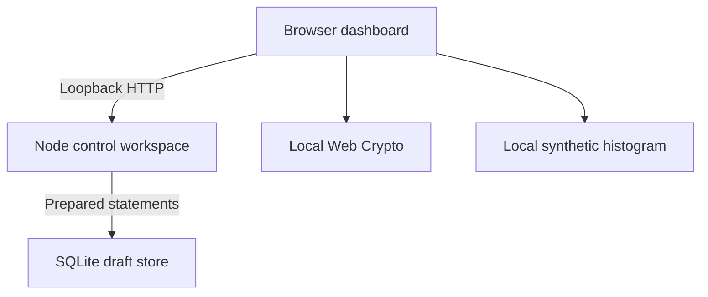

# Architecture

## Runnable foundation

The control workspace renders pages, serves a fictional manifest, and owns the draft store. The browser calculates report-manifest fingerprints and updates an illustrative histogram without a write to that store. There is no protected measurement endpoint.

## Target topology

The browser will shard and encrypt each report for the two aggregators. The control API will verify membership and authorize admission. Each aggregator will hold its own keys and protocol state. The collector will combine aggregate shares, apply the fixed privacy policy and persist a single release. The publisher will commit the approved manifest digest to the local chain. The verifier reads the expected chain independently. See the full topology and state machine in §2 of the specification.

The Node HTTP and SQLite foundation is an offline-host adaptation. Move the draft store and control boundary into the planned Fastify/PostgreSQL layout when the workspace can provision the protocol services and exercise their identities and permissions.
