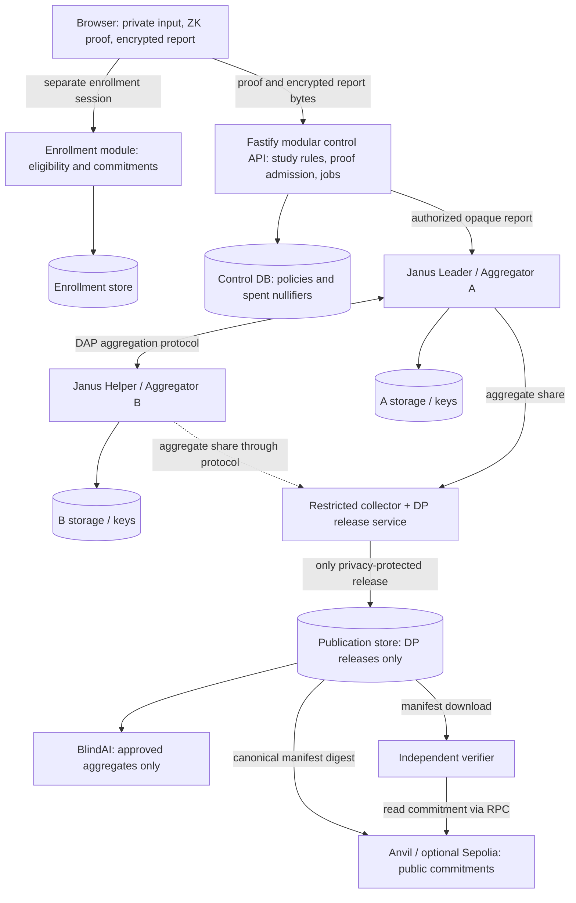

# BlindBench — Codex Master Build Specification

**Version:** 1.0 | **Status:** Approved project direction; implementation not started by this document  
**Tagline:** Collective intelligence without individual exposure.  
**Target:** A flagship SDE resume and GitHub project, built and understood end to end by one intermediate developer using Codex.  
**Timebox:** 30 days; adapt to actual available hours.  
**Repository:** https://github.com/darshans-codes/blindbench  
**Companion process manual:** `Solo_Project_Codex_Engineering_OS.pdf` (six pages).  
**First remote push:** Only after the verified 25% milestone defined in §18. No public production launch or real personal data is required.

---

## 0. START HERE — instructions to Codex

You are the principal implementation agent for BlindBench. This is an executable project brief, architecture specification, acceptance contract and build plan, not a request for another proposal. Read it fully, then read the companion PDF fully, inspect the workspace, and begin implementing in small verified vertical slices. Do not stop after generating documentation or a dashboard. Deliver working software and reproducible evidence.

### 0.1 How the two files work together

- The PDF is the **engineering operating system**: process, tool-selection rules, architecture discipline, quality gates, documentation and review. This Markdown is the **BlindBench product and technical specification**: what to build, why, boundaries, implementation order and measurable success criteria.
- Apply both together. Specific project constraints here supersede generic defaults such as a 24–48-hour hackathon, managed hosting or public staging when those do not fit this project. The PDF's requirements for security, evidence, maintainability and truthful reporting remain in force.
- If a real conflict or dependency incompatibility exists, record an ADR with the conflict, alternatives, evidence, resolution and revisit trigger. Do not silently drop a privacy guarantee or redefine a milestone. Use the safest small solution; ask the owner only when a genuinely blocking decision, external permission, secret or paid/destructive action is needed.
- Read existing `AGENTS.md` and nested instructions. Preserve existing work. Create or merge a **concise** root `AGENTS.md` with non-negotiable rules, commands, references to this spec and the derived project docs. Do not copy this entire master spec into AGENTS.md. If the agent cannot read PDFs directly, extract text locally (e.g., `pdftotext -layout`) or use the attached PDF viewer. Verify the PDF contents before relying on them; the crosswalk below is not a substitute for reading it.
- Put this master spec in `docs/BLINDBENCH_SPEC.md` or retain its existing path and link to it. Keep the supplied PDF and its extracted text local by default unless the owner explicitly wants them committed and has redistribution rights. Create a locally usable process summary in `docs/ENGINEERING_PLAYBOOK.md`; future sessions must not depend on re-uploading the PDF.
- In a fresh session, read `AGENTS.md`, this spec, `docs/PROGRESS.md`, `docs/QUALITY_REPORT.md`, outstanding ADRs and git status. Resume from the first unmet acceptance item rather than rebuilding everything.
- Do not assume tool access, model access, GitHub credentials, package availability, internet, OS or Docker support. Inspect the actual environment. On Windows, document PowerShell and/or WSL2 instructions as appropriate. Use the available coding model; do not claim a particular model was invoked if it was not.

### 0.2 Immediate actions (execute, do not just describe)

1. Inspect cwd, tree, git status/remotes/branches, README, manifests, existing tests, local runtimes and Docker. Never overwrite unrelated work. If workspace is empty and permitted, clone the specified repository or initialize a local project after confirming remote state; no remote writes yet. Do not create a different GitHub repo.
2. Create/update the documentation inventory in §16, beginning with `PROJECT_BRIEF.md`, measurable acceptance criteria, UX flow, risk register, `TOOL_DECISIONS.md` and `PROGRESS.md`. Mark all gates honestly as pending/blocked until tested.
3. Create minimal monorepo scaffold, local configuration, migrations, health checks, CI config and an initial original design system. Perform the protocol compatibility spike (§6) immediately; it is the largest risk.
4. Build the first real end-to-end private histogram slice before investing in elaborate UI. Keep the repository runnable after each slice. Commit locally as work passes checks; no remote writes until §18.
5. Continue through the milestone ledger in §17, updating progress/quality/evidence after each task. At the verified 25% milestone, execute §18 and verify the remote commit. Continue implementation after the checkpoint unless the owner asks to stop; do not claim background execution if the session ends. Persist the next exact task.

### 0.3 Rules that must survive all refactoring

- Never send, store, log, trace, cache or transmit a participant's original private measurement outside their browser in the protected flow. Synthetic baseline and explicitly isolated attack labs are the only exceptions; label them prominently.
- Never implement fake cryptography, fake proof checks, hard-coded successful verification, simulated production results or fabricated metrics. Never fix a failing test by weakening security or removing the assertion.
- No single aggregation service, ordinary backend, AI component or public API can receive both individual plaintext shares. Separate keys, credentials, storage and network boundaries. Local containers under one operator demonstrate logical separation, not independently operated trust domains.
- Never present blockchain commitments as proof of correct computation, privacy as unconditional, or a valid input as truthful. Clearly distinguish protocol validity, authorization, result integrity and statistical privacy.
- Use synthetic datasets exclusively. Do not solicit real salaries, health data, government IDs or other private records. No public registration, real credential issuance, crypto payments, tokens, wallets for participants or mainnet deployment.
- No secrets in git, logs, screenshots, prompts, test artifacts or public chain. No unapproved paid services, external destructive actions or public deployments. Use local Anvil and a deterministic non-AI fallback by default.
- Read current official docs, check releases/licenses/security and pin compatible dependency versions. Do not invent APIs, clone arbitrary starter repos, execute unknown installers, or use custom cryptographic primitives in the protected flow.
- Maintain one principal coding agent at a time; tools support engineering, not replace it. Keep owner understanding and interview explainability central.

## 1. Product brief and scope

BlindBench is a browser-based privacy engineering workstation. A study creator defines a bounded measurement schema and immutable release policy. Eligible participants contribute privately using zero-knowledge membership proofs and encrypted distributed reports. Two aggregators cooperate to validate and compute aggregate statistics. A restricted collector applies differential privacy before publication; an independent verifier checks blockchain-backed commitments. AI explains only the approved release. A separate lab demonstrates attack defenses and trust limitations, and a benchmark suite measures real costs.

**Audience:** Recruiters, SDE interviewers, computer science students and developers evaluating a realistic privacy-preserving analytics workflow. **Primary user journey:** interviewer creates/opens a synthetic study, privately contributes, sees the duplicate defense, triggers aggregation, inspects a noisy published histogram, verifies a result manifest and runs an adversarial experiment. **Success:** a clean, reproducible local demo that makes real protocol execution visible and explains its limitations.

### 1.1 What makes it differentiated

| Capability | Engineering achievement |
|---|---|
| BlindCompute | Real validated distributed aggregation of bounded private reports rather than encrypted storage |
| GhostID | Anonymous membership with proof-bound reports and study-specific duplicate prevention |
| Privacy Firewall | Restricted, budgeted, immutable differentially private release |
| ProofLedger | Independently inspectable study/result commitments and tamper verification |
| AdversaryLab | Repeatable synthetic security experiments, including explicit trust-assumption failures |
| BlindAI | Aggregate-only AI analysis with deterministic numeric claims and fallback |
| Performance Lab | Measured cryptographic overhead, utility loss and recovery behavior |

The distinctive work is the coherent composition, state machine, policy engine, orchestration, auditability and experiments. Prio, Semaphore, DAP and differential privacy already exist. Do not claim a world-first cryptographic invention.

### 1.2 Priorities

**P0, mandatory for the resume-ready version:** one real private bounded histogram; two aggregators; ZK membership and report binding; duplicate/replay protection; one DP release per study; local-chain immutable commitments and independent verification; functional browser journey; security experiments; reproducible tests, metrics and documentation. A working local deployment suffices.

**P1, only after P0 is robust:** aggregate-only AI explanations (deterministic fallback mandatory); visual protocol traces; additional study templates; enhanced monitoring; richer benchmark visualizations; optional Sepolia testnet with permission and no personal data.

**P2, explicitly deferred:** general private SQL, arbitrary/overlapping queries, multi-organization governance, distributed noise generation, malicious-collector resistance, end-to-end verifiable computation, homomorphic encryption, advanced MPC, Kubernetes, enterprise SSO, mobile native apps, real-user production service. Do not add these to the completion denominator.

### 1.3 Demo datasets

Seed deterministic, fictional data and known ground truth. One shared engine, not separate applications. First use compensation bins (annual INR lakh, integer category index only; e.g., `<4`, `4–6`, `6–8`, `8–10`, `10–15`, `15–20`, `20+`; document exact inclusive/exclusive edges). Secondary templates: network latency/speed, rental price, security incident counts. No real records. A demo batch may use 30 or more synthetic participants, with a configurable fixed minimum declared before collection. Benchmarks use 100/1,000/10,000 reports subject to resources. Clearly mark all seeds/synthetic observations; never invent measured results.

## 2. Architecture decisions and trust boundaries

Follow PDF p.1 modular-monolith preference. Build a **modular control application**, not a fleet of unnecessary microservices. Separate only components whose trust or runtime requires it: two aggregators, restricted collector/privacy release, local chain; optional worker process from the same backend codebase. Separate identity module and storage credentials inside the control application; if co-located, document that process compromise can expose enrollment and submission metadata. Do not claim operator-level unlinkability from logical modules alone.



Diagram is logical; exact DAP request routing follows the pinned implementation. The browser receives public task configuration, public encryption keys, group root, study schema and release policy. Enrollment has no access to report payloads. Admission sees a proof and ciphertext, never plaintext. The DAP leader may see encrypted helper payloads but not decrypt them. Each aggregator retains only its protocol-required data, with distinct keys/storage roles. The collector can see exact aggregates transiently and must be trusted to apply privacy correctly. The public API, AI and blockchain only see approved DP releases and non-sensitive metadata. No raw aggregates in general application storage or telemetry.

### 2.1 Security plane separation

| Plane | Owns | Cannot access |
|---|---|---|
| Enrollment | demo eligibility, issued commitments, group roots | private measurements, report storage |
| Control/admission | policies, proof validation, nullifier reservation, jobs, encrypted report references | aggregator private keys, raw values, exact aggregate |
| A / B | respective protocol state, independent key and DB | other aggregator's keys or plaintext shares |
| Collector/release | aggregate shares, transient exact aggregate, DP policy and release | individual raw values / ordinary AI endpoints |
| Publication/AI | approved release, safe manifest, explanations | exact aggregates, raw reports, identity tables, secrets |
| Chain | study/result commitments, lifecycle events | private inputs, nullifiers, identities, participant timestamps |

Use dedicated Compose networks and least-privilege roles, no shared writable key volumes, no Docker socket inside web services, no host-published internal service ports by default. A single laptop/root user can inspect everything; explicitly demonstrate rather than conceal this limitation. Prevent participant direct access to the aggregation leader from bypassing admission: leader ingress is private or enforces a tested admission proxy/authorization layer. Do not expose the unguarded upload path for convenience.

### 2.2 Study and release state machines

`DRAFT -> COMMIT_PENDING -> COMMITTED -> COLLECTING -> SEALED -> AGGREGATING -> PROTECTED -> ANCHOR_PENDING -> PUBLISHED`.

- Rules editable only in DRAFT; commit freezes canonical schema, eligibility root/policy, task ID, measurement encoding, privacy parameters, deadline/release plan and protocol version. Confirm local-chain transaction before collecting. No mutation after commit.
- Seal closes admission atomically; admitted/pending reports must be reconciled before batch is final. Document the acceptance cutoff and reject late uploads. Use one fixed batch per study; no chosen subsets.
- Job status (`QUEUED/RUNNING/RETRYABLE_FAILED/FAILED/SUCCEEDED`) is separate from domain state; durable transitions, locks, explicit failure codes, bounded retries and idempotency. Never reopen a sealed study to fix errors.
- Use single release ID per study and immutable release bytes. Reserve privacy budget, compute once, atomically persist release in the restricted publication path before exposing it, retry anchoring the **same** bytes. No second independent noise sample on HTTP refresh or crash retry after output exposure.
- Anchor pending is not published. Failed blockchain writes can retry safely. If a study cannot reach minimum batch or protocol validity, publish no statistics; terminal `ABORTED` or failure state with privacy-safe error. Do not leak exact small-group participation counts or reasons via public status/chain. Document metadata policy.

## 3. Technology stack and dependency rules

Choose stable versions supported by each other **after testing**, not arbitrary latest. Record exact versions, source URLs, licenses, compatibility and rejected alternatives in `docs/TOOL_DECISIONS.md` and lockfiles.

| Layer | Default decision | Constraint |
|---|---|---|
| Monorepo | pnpm workspaces + TypeScript strict; supported Node LTS | one scaffold; no unnecessary Turborepo unless measured need |
| Web | Next.js App Router, React, TypeScript | participant cryptography in client-only worker/module, no server action for raw input |
| Design | Tailwind CSS, shadcn/ui, Lucide, Geist Sans/Mono | original DESIGN.md; motion only where meaningful |
| Charts/graphs | Apache ECharts; React Flow if needed | accessible tabular fallbacks; lazy load heavy panels |
| Control API | Fastify + Zod + OpenAPI | modular monolith, typed contracts, server authorization |
| Persistence | PostgreSQL + one typed migration/query library (e.g. Drizzle) | separate DBs/roles for trust boundaries; no unnecessary database products |
| Identity | Semaphore V4 or verified compatible stable release | official library and circuit artifacts; no custom ZK circuit for MVP |
| Aggregation | Janus + compatible Prio3/VDAF/DAP implementation | real integration spike is mandatory |
| Browser report client | compatible Divvi Up TS SDK or maintained library-backed browser/WASM adapter | must generate encrypted reports locally; verify versions and security |
| DP | Python + OpenDP, minimal internal service/collector adapter | fixed bounded histogram mechanism, fail closed |
| Blockchain | Solidity, OpenZeppelin utilities, Foundry + Anvil, viem | local first; no paid or mainnet deployment |
| Jobs | PostgreSQL durable job table/outbox initially; Redis + BullMQ only if justified | ADR on concurrency/retries, avoid duplicate queue systems |
| AI | Vercel AI SDK or small typed provider adapter (choose one) | optional external API, default deterministic fallback, budget cap |
| Testing | Vitest, Fastify inject/API tests, Playwright, Pytest, Foundry | real integration profiles in CI; mock tests not substitutes |
| Observability | structured logs, OpenTelemetry, Prometheus metrics; Grafana optional | redacted metadata, no raw values, no sensitive labels |
| Infrastructure | Docker Compose, GitHub Actions, local HTTPS when externally exposed | no Kubernetes; optional authenticated staging only |
| Performance | k6 or equivalent reproducible load harness | actual measured runs, seed/hardware/versions recorded |

**PDF tool selection:** this is a dense analytics/dashboard app. Choose shadcn/ui + a single original `docs/DESIGN.md`, optionally a single curated Awesome DESIGN.md reference (e.g. calm Linear-like dashboard inspiration; not a clone). Use Impeccable for critique/audit/polish only if available and compatible; otherwise execute manual audit and record the substitution. Playwright CLI/browser tooling for screenshots and interaction tests. Bruno and Excalidraw optional documentation aids, not required runtime dependencies. ECC only a minimal compatible planning/review profile if already available and useful. No Taste Skill competing design direction, T3/bolt second scaffold, 3D/img2threejs, scraping/Firecrawl, Composio, CopilotKit, Browser Use, NocoDB, Meilisearch, Supabase, Trigger.dev, Coolify or Magic UI by default. Explain selection, installation/security/cost and revisit triggers, not just a list of rejected tools. Verify source READMEs and licenses before adoption. Never blindly install an entire catalog.

## 4. BlindCompute — distributed private computation

### 4.1 Protocol contract

- Fix histogram length and allowed categories in a committed task. Encode input as category index/one-hot as required by the selected Prio3 histogram implementation; use its real validity mechanism to enforce permitted contributions. Do not accept arbitrary arrays or trust frontend validation alone.
- Use browser crypto RNG and library-backed client encryption for leader/helper HPKE report shares. Use the pinned DAP encoding and task parameters; do not invent serialization or substitute transport TLS for share encryption.
- Browser sends only opaque encrypted report bytes to admission; never send a separate raw category, debug value, raw one-hot vector or unencrypted share to the normal backend. Ensure bundling/worker boundaries prevent server execution. Do not persist raw input in browser storage; clear input state on success where practical, no analytics SDK/session replay on this route.
- DAP replay checks and validated reports precede aggregation. Collector gets only aggregate shares and cannot request individual reports. Only approved fixed task/batch can be collected. Do not build an endpoint for arbitrary aggregate collection.
- Retain protocol state only as required for completion/retries, document cleanup schedule. No production-grade deletion guarantees are claimed; synthetic demo resets are isolated.

### 4.2 Correctness and negative tests

Test known synthetic histogram against a conventional in-memory baseline in a separate test process. For example, 30 valid reports split across fixed bins must yield exactly the expected counts **before DP**, asserted inside the restricted test harness. Do not expose exact histogram through normal API. Test malformed report, wrong task, invalid category/one-hot via library fixtures, damaged ciphertext, invalid proof, replay, out-of-window report, insufficient batch, helper unavailable, recovery and duplicate job. Show which checks belong to the VDAF versus admission layer. Report validation rejects malformed measurements, not dishonesty within valid bounds.

## 5. GhostID — anonymous authorized participation

- Use a seeded demo enrollment authority: one eligibility token or allowlisted test account per synthetic member; atomically consume enrollment entitlement once, record issued identity commitment. Generate identity secret locally; never send secret to enrollment or API. Explain reset/recovery limitations; no real university verification.
- Build Semaphore group and validate accepted root(s) against the frozen study eligibility policy. Prefer a snapshot root for MVP; if root evolution is necessary, record exact allowed roots and cutoff in policy. Verify proof with official package/circuit version and artifacts, not proof existence or client boolean.
- Derive a domain-separated scope from application/environment ID and immutable study ID using the library-supported field conversion. Bind proof message to a canonical digest of the exact encrypted report bytes plus task/study context; document conversion/serialization and ensure client/server use identical vectors. Use official library methods for hashing-to-field/message semantics. Do not use a global nullifier that links multiple studies.
- Admission verifies proof, root, scope, message, report/task binding and study state. Atomically reserve `(study_id, nullifier)` with unique constraint and associate a stable report ID/digest. Same report retry returns same admission status; different report with same nullifier is rejected. Use transaction + durable outbox, stable DAP report IDs and reconciliation on ambiguous network failures; do not consume a credential forever due to an ordinary lost response without a recovery path. Never accept a different report under a previously reserved nullifier.
- Keep admin authentication separate from participant proof verification. Use secure cookie/session auth for study owner and synthetic enrollment administration; no login cookie on anonymous submit route when feasible. CSRF protection on authenticated mutations, scoped authorization, deny-by-default, no public admin endpoints. Rate limit expensive proof verification without permanent identity/IP tracking; use short-lived pseudonymous buckets and document metadata leakage.
- Tests: wrong root/scope/message; changed ciphertext; wrong study; concurrent duplicate requests; same-request retry; second enrollment; expired/frozen study; cross-study participation permitted with different scoped nullifiers. Verify no identity is included in report submission. Document enrollment timing, IP correlation, malicious browser and credential sharing risks. Never call this absolute anonymity.

## 6. Mandatory compatibility spike — before feature expansion

The existing project discussion identified potential version mismatch between older browser DAP clients and newer Janus versions. Treat this as an unresolved engineering risk, not a verified current compatibility claim.

1. Inspect official Janus releases/docs, client SDK releases, supported DAP draft/RFC and VDAF version, HPKE suite, Prio3 histogram support, task provisioning, minimum batch configuration and collector API. Record a version matrix with actual sources and pinned image digests/tags, package versions and toolchain. Check license and advisories.
2. Bring up leader, helper, separate stores, task provisioning and collector locally. First run official fixtures; then generate a report in a real browser context with the chosen SDK. Aggregate known synthetic bins and assert exact result in a restricted test harness.
3. Prove malformed/replayed reports are handled, no raw input traverses the control API, and no individual share crosses trust boundaries. Save redacted actual commands, exit statuses, logs, versions and test evidence. Write `docs/adr/0002-private-aggregation.md` and `docs/protocols/COMPATIBILITY.md`.
4. If the preferred pair fails after a bounded investigation, try a compatible pinned release pair or maintained library-backed client adapter. If DAP integration is not feasible, use a vetted Prio3/VDAF library to implement a clearly labelled **experimental distributed aggregation transport** with actual independent encryption, validation and replay controls. Do not call it DAP compliant; record changed guarantees and update tests. Browser generation remains mandatory for the protected flow. If neither path works, mark the core and 25% gate BLOCKED; do not ship a central plaintext substitute or promote a toy secret-sharing demo to real crypto.
5. Educational secret-sharing visualization is allowed only under `/privacy` or an isolated lab, prominently labelled simulation. Cryptographic production code must use reviewed library implementations; demo arithmetic is not security evidence.

## 7. Privacy Firewall — fixed differentially private releases

Use a bounded, one-contribution-per-credential histogram and a single approved release per study. Declare privacy unit (one eligible participant), neighboring relation (prefer add/remove one bounded contribution), sensitivity (L1 = 1 for a one-hot histogram under add/remove; replacement adjacency would be 2), mechanism, epsilon and delta before collection. Default proposed epsilon 1, delta 0 for a pure DP Laplace mechanism if the validated implementation supports it. Verify against OpenDP docs and record actual parameterization and numeric representation. Do not hand-write production noise generation.

- Use OpenDP or equivalent established library with a documented sensitivity proof/measurement map. If using independently noisy bins, justify the joint histogram privacy guarantee with the vector sensitivity, not an unsupported per-bin assumption.
- Batch policy: fixed collection window and minimum size; exact threshold decisions can themselves leak membership. Describe DP claim for the released histogram conditional on the declared release policy; either make threshold behavior privacy-protected or explicitly limit the guarantee and suppress public exact counts/status details. Never claim end-to-end DP across enrollment, timestamps, metadata and multiple studies.
- Restrict collector to one full batch, no arbitrary subsets, cohort filters, exact totals, per-participant output, repeated queries or debug route exposing exact counts. No public sample size unless public by design (synthetic benchmark) or derived from DP output and clearly labelled.
- Store approved release atomically under unique study/release ID. Track budget reservation/consumption and canonical result bytes. Failed unpublished computation can be retried under documented semantics; once a release exists, reuse identical bytes even after chain failure. Do not resample on refresh. Use test-only injected RNG or fixtures where necessary; production uses cryptographically suitable randomness, never a public deterministic seed.
- Clamp negatives/round counts using deterministic post-processing; compute approximate median/percentiles from the released histogram with stated bin/rounding limitations. Never calculate an exact quantile from raw data. Label privacy parameters, output distortion and uncertainty; not a confidence interval unless calculated correctly.
- Restrict overlapping studies in MVP to synthetic independent cohorts or one study per registered demo cohort; do not claim cross-study privacy accounting. Document composition and future ledger design. AI operates only on released histogram, so it is post-processing of the release, not extra raw-data access.
- Tests: known sensitivity, policy immutability, reject unsupported epsilon/out-of-range settings, no raw aggregate leakage, replay same release after job retry, no re-noise, small batch abort, rejected arbitrary filter, budget enforcement under concurrency. Measure utility on synthetic baseline with repeated independent *experimental* runs; do not allow repeated releases in normal workflow.

## 8. ProofLedger — independently verifiable commitments

Build a minimal Solidity contract with role-restricted `commitStudy`, lifecycle close/abort and `commitResult` operations; exact names may vary in ADR. Enforce one immutable policy commitment per study and one result commitment after close. No upgradeable proxy unless necessary. Use Foundry tests and local Anvil first. Optional Sepolia only with explicit owner permission and test credentials; no mainnet, no participant wallet, no tokens or value transfers.

- Canonicalize public study manifest and public result manifest using a deterministic documented standard (e.g. RFC 8785 JSON canonicalization) and domain-separated hash (choose SHA-256 or Keccak-256 consistently; test vectors across browser, backend and contract). Avoid floats/ambiguous numeric strings, specify UTF-8 and schema version. Hash manifest content excluding its own hash and tx reference. Chain metadata lives in a separate envelope.
- Study manifest: schema version, public study ID, measurement bins, release policy, protocol/version, frozen group-root policy, task context (only safe public identifiers), and relevant public config digest. Result manifest: study commitment, release ID, approved noisy histogram, privacy parameters/adjacency, release format and relevant implementation version. No raw values, exact private counts, identity commitments per individual, nullifiers, secret shares, proof payloads or participant-level timestamps. Review whether any public metadata leaks information.
- Use contract `bytes32` commitments and explicit study state; events allow independent reading. Publisher service uses least privilege, server-only keys and transaction idempotency. Handle pending/reverted/unavailable RPC, confirmation policy and safe retries. Local chain resets are documented; a verification result from a reset chain is not historical evidence.
- Independent `/verify` page accepts manifest file locally, canonicalizes, computes hash, reads configured chain ID/contract via RPC independently of control API, checks committed study/result digest, state and receipt where applicable. Verify chain ID/address against known trusted configuration; do not trust arbitrary uploaded RPC URLs or server-supplied expected hash alone. Provide standalone CLI/SDK command for recruiters. Results: MATCH, MISMATCH, UNANCHORED, WRONG_CHAIN, UNAVAILABLE, INVALID_FORMAT; never return success on error.
- Optional Merkle trees for batched **public manifest** commitments only if multiple releases justify batching; Semaphore group already provides Merkle membership. Do not add individual report inclusion proofs to public ledger in MVP. Contract tests cover role denial, duplicate commits, invalid transition, altered digest, no overwrite and failure/retry. Tamper demo edits one released bin in a downloaded manifest and fails verification.
- Guarantees: published artifact integrity and commitment ordering under chain assumptions. Does not prove computation accuracy, issuer honesty, that noise was applied, or privacy. Local Anvil is a demonstrator, not decentralized consensus; state this in UI and README.

## 9. AdversaryLab — real security experiments

Run only against isolated, owned, synthetic test infrastructure with allowlisted experiment IDs. No arbitrary command execution, user-supplied targets, public attack endpoint or live sensitive study. Use disposable task IDs/storage/keys, resource/time limits and safe cleanup. Require explicit synthetic lab mode. Show actual test outcome and safe trace, not a fixed success animation.

| Experiment | Expected outcome / evidence |
|---|---|
| Repeated enrollment | second entitlement use rejected |
| Duplicate contribution | exactly one accepted under concurrent requests |
| Proof substitution | proof bound to original bytes; modified report rejected |
| Invalid measurement | actual VDAF fixture rejected |
| Report replay | no double count, stable result |
| Ledger tamper | altered public manifest hash differs |
| Privacy release retry | same approved bytes, no extra budget |
| Small batch / forbidden filter | no unapproved statistics released |
| Helper outage | job stays pending/failed safely, resumes without duplicate publish |
| Aggregator collusion | explicitly simulated synthetic shares can reveal original value; limitation, not defense |
| Collector compromise | demonstrate/document exact aggregate trust exposure in isolated harness, no claim of protection |
| AI boundary | attempted prompt override cannot access raw data or execute tools |

Build a typed experiment registry, preconditions, bounded worker, teardown, assertions and structured sanitized results. Mark outcomes as PASS/FAIL/BLOCKED/DEFERRED with timestamp and commit. Separate UI demonstration (illustrative) from real experiment (executed). No production/debug access to plaintext values through this module.

## 10. BlindAI — aggregate-only intelligence

- AI is a supporting feature. Use deterministic code to calculate released histogram totals/approximate quantiles, comparisons and uncertainty notes; send only approved release JSON and safe derived facts to a single restricted adapter. No raw inputs, exact aggregate, admin data, logs, database tool, web browsing, wallet or policy-changing tool. No agentic external actions.
- Provide structured output schema such as `summary`, `observations[{metricId, text}]`, `limitations[]`, `releaseId`. Validate IDs and numerical claims against deterministic facts. Reject unsupported assertions, inferred individual attributes or recommendations based on unreleased data. Treat study names/labels as untrusted; delimit data and do not execute instructions from it.
- Version prompt/model/config, record sanitized latency, token/cost and failure metrics. Per-user/global quotas, request timeout, bounded retry and fallback. Cache only approved aggregate explanations by immutable release hash + prompt/model version if useful. Never cache secrets or use raw user queries to fetch additional statistics. API key server-side only.
- Offline default: templated, clearly labelled deterministic explanation. External provider disabled without owner-approved key/budget; no paid calls just to satisfy demo. UI distinguishes AI-generated vs deterministic output. Fixtures test injection, incorrect numbers, missing key, timeout, quota, invalid response and aggregate-only payload. Record actual evaluation outcomes, not claimed AI accuracy.

## 11. Website experience and design specification

Build a cohesive, calm, premium privacy engineering workstation, not a marketing-heavy landing page or generic AI SaaS template. The visual language is original; inspiration from a curated dashboard reference may inform spacing/density, not brand identity. Design before adding decorative components. Use one visual director (`docs/DESIGN.md`) and a finishing audit per PDF pp. 1–4.

### 11.1 Design tokens and interaction standards

| Token | Dark default |
|---|---|
| Canvas / surface / elevated | `#0B101A` / `#141D2C` / `#202C42` |
| Border | `#334155` (adjust interactive boundaries for contrast) |
| Text / secondary | `#E2E8F0` / `#94A3B8` |
| Cryptography accent | `#818CF8` (use accessible lighter accent for small text) |
| Verified / warning / danger | `#2DD4BF` / `#F59E0B` / `#EF4444` |
| Typography | Geist Sans and Geist Mono; self-host or safe fallback |
| Spacing | 4px base, 8/12/16/24/32/48px; radius 6/10/12px |

Desktop: persistent left navigation (~220px), compact command header, generous main content width, optional contextual inspector drawer. Mobile: accessible collapsible nav, single-column layout, scrollable complex tables with headers, touch targets of at least 44px. At 390px no unintended horizontal scrolling. Use readable text sizes and chart labels, WCAG 2.2 AA contrast target, focus-visible, keyboard navigation, semantic heading hierarchy, accessible names, status text not just color, reduced-motion support. Provide chart data tables and static descriptions for protocol graphs. No 3D. Use subtle motion for actual protocol progress or transitions; no constant glowing background or decorative animations. Loading, empty, failed, offline, unavailable and unanchored states must be real, visible and actionable. Respect user's system theme if a light theme is implemented; dark is enough for core MVP.

### 11.2 Route map and acceptance behavior

| Route | User action and result | Priority |
|---|---|---|
| `/` | Concise value proposition, trust caveat, launch local synthetic demo, documentation link | P0 |
| `/overview` | Real study summaries, health indicators, last release and next actions; no invented counts | P0 |
| `/studies` | Browse/filter demo studies; open actual detail, create study, inspect state | P0 |
| `/studies/create` | Wizard: template → bins → eligibility → privacy policy → review and commit; validation, cancellation | P0 |
| `/studies/[id]` | Immutable rules, status, permitted admin actions, released histogram, manifest download | P0 |
| `/participate/[id]` | Enrollment/proof if needed; private input, local processing progress, submission receipt, retry/duplicate states | P0 |
| `/compute` | Actual jobs, stage trace, aggregator health, safe retry; sanitized inspector, no shares | P0 (basic) |
| `/identity` | Group and proof explanation, scoped membership demonstration, synthetic credential enrollment | P1 standalone; core flow P0 |
| `/privacy` | Privacy–utility simulator with synthetic truth and clearly illustrative/actual experimental mode | P1 standalone; release controller P0 |
| `/adversary` | Select allowlisted synthetic scenario, execute, display evidence and trust limitation | P0 (at least core scenarios) |
| `/ledger` | Study/result digests, chain ID, contract address, confirmed/pending status, receipt | P0 |
| `/verify` | Upload public manifest; locally compute digest; independently read chain; show exact status | P0 |
| `/insights` | Approved release only; deterministic explanations/optional AI; show privacy and inference limits | P1 |
| `/benchmarks` | Read measured run artifacts, compare baseline/private/DP, hardware, p50/p95, utility and error | P0 (basic) |
| `/system` | Safe health, queues, versions, degraded services; internal monitoring links only where configured | P1 standalone |
| `/docs` | Protocol overview, threat model, limitations, reproducible commands | P0 (may be README links initially) |

Combine low-priority screens as tabs initially; do not create dead navigation, placeholder buttons or disconnected demos. If feature deferred, omit it or explicitly label as not implemented. A dashboard number must come from a real approved API or explicitly synthetic fixture; do not expose exact participant count for a protected study. Charts and logs never contain secrets. Admin and participant roles are visually and technically separated.

### 11.3 Essential UX journeys

1. Creator signs in (local demo admin), chooses compensation template, defines fixed bins/epsilon/window, commits policy on Anvil, opens study. Review screen explains immutability. Errors preserve safe form state.
2. Participant opens a separate browser session, obtains seeded membership entitlement, chooses synthetic measurement, generates encrypted report/proof in browser, submits, sees status and opaque receipt. A network retry is safe; a different duplicate report is rejected. No raw value in server logs, URLs, browser storage or receipts.
3. Creator seals study, queues aggregation, watches actual sanitized phases, handles helper unavailable, publishes approved histogram after DP and confirmed anchor. Results display privacy policy, approximate interpretation, limitations and provenance.
4. Verifier downloads manifest and opens `/verify` from a separate session. Original matches, altered copy fails; chain unavailable does not return success.
5. Interviewer runs synthetic AdversaryLab test and compares measured result/benchmark. All actions work with no external AI API and no public chain.

## 12. Data model and persistence

Use migrations, constraints, typed repositories, fixtures and role-based DB permissions. Keep secrets separate from persistent public metadata. One local PostgreSQL instance may host separate logical databases for the portfolio demo, but use separate credentials and no cross-service grants; use separate volumes/instances for aggregators where practical. Document common-host compromise. Never use a single superuser credential everywhere.

| Entity | Key fields / invariants |
|---|---|
| `communities` | UUID, name, public group config; synthetic only |
| `membership_credentials` (enrollment store) | entitlement identifier/hash, identity commitment, consumed_at; unique entitlement and commitment; no identity secret |
| `group_snapshots` | group ID, root, version, allowed policy; frozen for study |
| `studies` | UUID, creator, community, state, version, task identifier, policy digest, timestamps, unique task mapping |
| `measurement_schemas` | study ID, version, category definitions, validation parameters; immutable after commit |
| `privacy_policies` | study ID, privacy unit, adjacency, mechanism, epsilon/delta, minimum batch and release plan |
| `report_admissions` | study ID, stable report ID, digest, scoped nullifier, status, safe retry metadata; unique report ID and `(study_id, nullifier)`; encrypted outbox only while required |
| `aggregation_jobs` / `outbox` | task/batch/job type, status, attempt, lease, next retry, correlation ID, safe error code; unique logical job key |
| `privacy_releases` (restricted/publication stores as designed) | unique study/release ID, canonical approved bytes, hash, budget record, publication state; no raw aggregate |
| `audit_commitments` | chain ID, contract, digest, tx hash, receipt status; unique logical commitment |
| `benchmark_runs` | git SHA, environment, workload, actual measurements, evidence artifact path; synthetic only |
| `experiment_runs` | allowlisted ID, synthetic run ID, outcome, safe evidence, duration |

No table of individual plaintext measurements. Aggregator schemas managed by pinned implementation. Index by observed query patterns (study state/owner, queued jobs by status/retry time, uniqueness for nullifiers and releases); record `EXPLAIN` evidence if tuning. DB transaction handles admission reservation and outbox; avoid false exactly-once claims across HTTP/DB/chain — use at-least-once delivery with idempotent effects and reconciliation. Migrations reversible where feasible or forward-repair plan; seed/reset must require explicit synthetic environment guard. Back up only appropriate synthetic state and encrypted protocol storage, protect keys separately; exercise restore in isolated environment and document what is unrecoverable.

## 13. API contracts and backend engineering

Versioned `/v1` routes, OpenAPI generated/checked from schemas, typed DTOs, strict size/time limits, consistent errors (e.g. RFC 9457 problem details with safe `code`, `requestId`, optional field errors). Do not echo proof/ciphertext/private data in errors. Use authentication/authorization middleware per route. Validate path/body/query and content types. Never trust UI-only role checks. Public result reads only published immutable releases.

| Method/path | Contract / authorization |
|---|---|
| `POST /v1/studies` | creator; schema, policy, template; create DRAFT |
| `POST /v1/studies/:id/commit` | owner; freeze policy, queue chain write; idempotent |
| `GET /v1/studies/:id/config` | safe public task/schema/root/config; no secrets |
| `POST /v1/membership/enroll` | synthetic entitlement; accept commitment, one issuance |
| `POST /v1/reports/admit` | anonymous proof + opaque encrypted report; verify and reserve; 202 + stable status receipt |
| `GET /v1/reports/:receipt/status` | opaque unguessable receipt capability or equivalent safe authorization; status only; no identity |
| `POST /v1/studies/:id/seal` | owner; atomic cutoff and reconciliation |
| `POST /v1/studies/:id/aggregate` | owner; fixed batch; idempotent job |
| `GET /v1/jobs/:id` | owner/operator; sanitized state and error code |
| `GET /v1/studies/:id/results` | published DP release only |
| `GET /v1/studies/:id/manifest` | immutable public manifest/envelope only |
| `POST /v1/verify` | optional convenience verifier; browser/CLI independent verifier remains required |
| `POST /v1/insights` | approved release ID; no arbitrary query/raw data; rate and cost limits |
| `POST /v1/lab/experiments` | local operator, synthetic mode, allowlisted scenario |
| `GET /v1/benchmarks` | measured synthetic run artifacts |
| `GET /healthz`, `GET /readyz` | safe health, readiness separated from liveness; no secrets |

Implement typed state transitions/services independent of HTTP. Retry only transient operations with bounded exponential backoff/jitter, timeouts and dead-letter/manual review. No blind retries for invalid proof or policy failure. Workers use leases and idempotency; document crash points and compensation/reconciliation. Use request IDs without sensitive correlation between enrollment and participation. Do not let client choose arbitrary URLs, chain addresses, external tool names or SQL. Rate limit expensive endpoints, protect CSRF/session cookies, restrict CORS, CSP, sanitize text/Markdown, safe file parsing on verifier, dependency and secret checks. Test error taxonomy, permissions, pagination and API contract changes. Real event traces may be polled first; SSE/WebSocket only if justified by UX and security review.

## 14. Quality, security and deployment

### 14.1 Threat model checklist

| Threat | Mitigation / residual risk |
|---|---|
| Unauthorized/duplicate participant | official proof verification + unique scoped nullifiers; issuance authority remains trusted |
| Changed report or replay | proof binding + stable report ID + protocol checks; test races |
| Malicious valid input | bound its contribution; cannot establish truthfulness |
| One aggregator compromised | only own shares/keys; other aggregator non-colluding; traffic metadata remains |
| Both aggregators or host compromised | confidentiality may fail; documented synthetic experiment |
| Malicious client code/browser | can observe input; trusted frontend delivery, CSP, dependency review; not solved by crypto |
| Malicious collector | exact aggregate visible; trusted DP release enforcement, no claim of protection |
| Statistical inference | one bounded fixed release, sensitivity-aware DP; metadata/threshold/composition caveats |
| Enrollment linkage | separate sessions/store, minimize IP/time logs; operator or network correlation still possible |
| Chain tamper/reorg/RPC error | commitments, confirmation and correct-chain checks; no proof of correct computation |
| Admin misuse | frozen policies, roles, audit logs, no raw aggregate route; host admin can still bypass process |
| Web vulnerabilities | authZ, validation, CSRF, XSS/CSP, size/quotas, safe serialization, dependency checks |
| AI data exposure / injection | approved release DTO, no tools, structured validation, fallback and quotas |
| Availability / service failure | health, leases, durable jobs, idempotency, bounded retries, fail closed |

Document assets, actors, trust boundaries, data flow, attack surface, likelihood/impact, controls, test evidence, residual risk and exclusions in `docs/THREAT_MODEL.md`. Use STRIDE/LINDDUN where useful; do not claim formal verification or independent audit. No real personal data, production SLA, compliance certification or absolute anonymity claims.

### 14.2 Minimum real checks

- Build, typecheck, lint/format and deterministic unit tests; domain lifecycle, canonicalization, policy, authorization, nullifier logic, error mapping, AI facts.
- Integration: actual PostgreSQL migrations/constraints and concurrent admissions, real browser proof/client report generation and two-aggregator collection, DP library release, Anvil contract verification and failure/retry. Test boundaries using least-privilege service credentials.
- Playwright: creator → commit → participant → duplicate → seal → compute → publish → verify → tamper; desktop and 390px mobile, keyboard/focus/labels, loading/empty/errors, helper/network failure, no raw measurement on protected network requests. Use controlled interception for UI failure tests but real backend/protocol integration separately. Use axe or equivalent and manual checks.
- Security: dependency audit, secret scan (including staged changes and commits before push), image scan when available, CSP/authZ/CSRF, rate limits (429), input limits, no secret/raw data in telemetry, no public internal ports; actual evidence. Test no raw value at ordinary API/DB/log sinks with synthetic canaries, avoiding false confidence from coincidental numeric strings.
- Foundry tests: roles, immutable commitments, transition ordering, duplicate write rejection, tamper; Pytest: DP parameterization, release idempotency and postprocessing; failure recovery including worker crash and chain unavailable.
- Record PASS/FAIL/BLOCKED/DEFERRED/N/A or SKIP with specific reason, commands, exits and artifacts. Never claim a tool ran because it was installed. Do not count mocked protocol as passing real crypto. Add tests before/with fixes, rerun targeted and global checks. Do not claim 100% security or coverage.

### 14.3 Local-first deployment and operations

Docker Compose is the reproducible reference environment: web, control API, DB roles/instances, two aggregator services, collector/privacy worker, local Anvil, optional monitoring and queue profiles. Keep resource use manageable; do not require Grafana/Redis/AI for core if not needed. Use pinned images, non-root where possible, read-only filesystem where compatible, health checks, resource limits, named service DNS and secrets via ignored env/local mounts. `.env.example` contains placeholders only. Configure readiness and ordering; no hardcoded IPs. Bind web/API to loopback by default. If remote authenticated staging is approved, configure HTTPS/reverse proxy, internal network restrictions, protected lab and cost estimate. No public release or paid infrastructure requirement. GitHub source publication at the requested checkpoint is distinct from app deployment.

Provide actual documented commands (names below are target conventions to implement, not assertions they already exist): `pnpm install --frozen-lockfile`, `docker compose up -d`, `pnpm db:migrate`, `pnpm demo:seed`, `pnpm dev`, `pnpm test`, `pnpm test:integration`, `pnpm test:e2e`, `pnpm check`, `pnpm bench`, `pnpm demo:reset` (guarded synthetic environment). A single `pnpm demo:up` or documented equivalent should launch the reproducible demo by final release. CI uses least permissions and no repository secrets for local integration; run build/lint/types/unit on each PR and mainline push after checkpoint, real integration/E2E/contract/DP checks on appropriate CI jobs. Pin actions/deps, protect untrusted PRs, do not expose secrets. Record local equivalent checks before first push. Document rollback, migrations, backup/restore, service failure runbook, resource usage and actual optional provider costs. No production-readiness claim without evidence.

## 15. Engineering benchmarks and interview evidence

Use a dedicated synthetic harness that can access baseline truth for tests only. Compare conventional in-memory aggregation vs real private aggregation vs private aggregation + DP; disclose any differences in workload, network and measurement boundaries. Benchmark 100, 1k, 10k reports when feasible; smaller completed runs count if hardware limits documented. Warmup, repetitions, p50/p95, throughput, CPU/memory, encrypted report bytes, proof generation/verification latency, aggregation/collection latency, DP error (e.g. MAE/RMSE per bin over repeated synthetic experiments), chain gas usage and failure recovery. Report sample count, machine specs, OS, Docker, versions, seed, commit, commands and raw measurement file; separate fixture charts from measured results. For a privacy–utility plot, compare multiple epsilon settings in separate synthetic experiments, not repeated normal releases. No fabricated targets or claims. Initial performance goals are hypotheses, not acceptance thresholds: functional demo completes on a developer laptop and no unbounded queue/latency growth; measure and document realistic budgets after spike.

Final recruiter story: problem → actual local computation → anonymous membership → DP trade-off → immutable result verification → failed attack/assumption → measured overhead and tradeoffs. Include a two-minute concise demo plus longer technical walkthrough. User learning notes explain additive shares, Prio validity, HPKE, DAP, ZK membership/nullifier, privacy adjacency/sensitivity, hash/contract verification, database transactions, retries, architecture and own code versus libraries. Do not represent generated code as entirely handwritten; owner must be able to explain it. Target resume bullets after implementation only:

- Built a distributed privacy-preserving analytics platform using validated cryptographic aggregation, with independently separated report-processing services.
- Implemented proof-bound anonymous report admission, scoped nullifiers, replay-safe orchestration and bounded differentially private statistical releases.
- Developed blockchain-backed artifact verification, adversarial experiments and reproducible performance/utility benchmarks; restricted AI to approved aggregates.

Replace these with measured, truthful specifics. Do not claim 10k throughput, privacy certification, user count or public adoption unless actually demonstrated. Maintain contribution log and generated/scaffolded disclosure.

## 16. Repository structure, documents and PDF crosswalk

Suggested structure; adapt to existing repo and minimal runtime boundaries. Do not create empty services just to match a tree.

```text
blindbench/
  AGENTS.md
  README.md
  SECURITY.md
  LICENSE                      # select with owner; don't change existing license
  .env.example
  .gitignore
  pnpm-workspace.yaml
  package.json
  pnpm-lock.yaml
  docker-compose.yml
  apps/web/
  services/control-api/        # modules: identity, studies, admission, jobs, publication
  services/collector/          # restricted aggregate and DP release boundary
  packages/privacy-sdk/        # browser report adapter
  packages/identity-sdk/       # official proof integration
  packages/verification-sdk/   # canonicalization / independent verifier
  packages/protocol-types/
  packages/ui/                 # only if reuse warrants package
  contracts/{src,test,script}/
  infrastructure/{aggregators,docker,monitoring}/
  datasets/                    # synthetic generators, no real data
  experiments/{security,failure-recovery,privacy-utility}/
  benchmarks/
  tests/{integration,e2e}/
  docs/
    BLINDBENCH_SPEC.md
    ENGINEERING_PLAYBOOK.md
    PROJECT_BRIEF.md
    TOOL_DECISIONS.md
    DESIGN.md
    ARCHITECTURE.md
    THREAT_MODEL.md
    RISK_REGISTER.md
    PROGRESS.md
    QUALITY_REPORT.md
    ENGINEERING_CONTROLS.md
    API.md
    DATA_MODEL.md
    RUNBOOK.md
    DEMO.md
    CONTRIBUTIONS.md
    adr/
    protocols/COMPATIBILITY.md
    benchmarks/
  .github/workflows/ci.yml
```

### 16.1 Required docs before and during implementation

- `PROJECT_BRIEF.md`: problem, users, value proposition, differentiation, demo, flows, constraints, measurable acceptance, risks/fallback. Derived from §1, §11 and §17. Create before architecture/code per PDF.
- `TOOL_DECISIONS.md`: selected tool/source URL/version/license, intent trigger, why, integration, costs/security, rejected alternatives. Verify tools before use. `DESIGN.md`: original tokens, component/layout spec, responsive and accessibility, reference provenance. `RISK_REGISTER.md`: risk, severity, likelihood, owner, mitigation, due point, status.
- `ARCHITECTURE.md`, `DATA_MODEL.md`, `API.md`, `THREAT_MODEL.md`: diagrams, trust boundaries, data lifecycle, invariants, contracts, error/retry behavior, limitations. Include measured evidence as it develops.
- `docs/adr/`: each ADR contains **Context, Decision, Alternatives, Consequences, Revisit Trigger**. Minimum ADRs: framework/modular topology, aggregation compatibility, data store/auth and anonymous enrollment, DP adjacency/release policy, ledger canonicalization/commit semantics, hosting/local staging, AI/fallback, queue/search/cache decisions, design system. Record why separate aggregators are necessary despite monolith preference.
- `PROGRESS.md`: fixed milestone ledger, evidence, completed weight, current branch/commit, blockers and exact next task; update at each accepted work item and session end. `QUALITY_REPORT.md`: columns exactly `Gate | Applicability | Result | Command/evidence | Issue | Fix / owner`; add date/commit if helpful. Use actual states PASS/FAIL/BLOCKED/DEFERRED/N/A (SKIP only with reason). `ENGINEERING_CONTROLS.md`: all 10 controls with applicability, status, evidence, owner, due point; review every milestone.
- `README.md`: actual launch steps, motivating problem, architecture diagram, demo, what we built vs integrated/scaffolded, data model and API, tests/CI, threat model, tradeoffs, measured performance, limitations, future evolution. `RUNBOOK.md`: startup, health, failure recovery, migrations, backup/restore, rollback and cost. `DEMO.md`: reproducible synthetic walkthrough. `CONTRIBUTIONS.md`: truthful user/agent/library responsibilities and learning notes.

### 16.2 PDF mapping (do not ignore any applicable section)

| PDF section | Project-specific implementation |
|---|---|
| p.1 solo principles, four-week baseline and quality | §0, §1–3, §12–15, §17; requirements first, modular control app, separate trust services, typed API/migrations/test evidence |
| p.2 M0–M5, ADRs and avoid overengineering | §16–17; local staging substitute approved by portfolio-only scope; no unnecessary services/Kubernetes |
| pp.2–4 intent-to-tool engine, design selection and catalog | §3, §11; original DESIGN.md + shadcn, Playwright, finishing audit, minimal tools with actual license/compatibility check |
| p.5 ten engineering concepts and operating protocol | §0, §14, §16.3, §17; controls applied with triggers, evidence, small commits and bounded fix loops |
| p.6 preflight, mandatory quality state log, kickoff and portfolio | §0, §15–18; answer preflight from brief, record actual gates, reproducible README/demo |

### 16.3 The PDF's ten adaptive controls — explicit decisions

Initial dispositions below are plans, not PASS. Review and update with actual evidence, owner and due point at each milestone.

| Control | BlindBench application / due |
|---|---|
| Rate limiting | Day one on enrollment/admin/expensive proof and AI; distributed/DB-backed quota if multiple processes; test 429 and privacy-safe buckets. M1–M3 |
| Caching | Defer until measured; only immutable approved release/AI explanation by digest, TTL/invalidation/version; never cache raw inputs/keys. M3/M4 review |
| Load balancing | Deferred local demo; if multiple control replicas justified, test stateless sessions, readiness and throughput. M4 review |
| Reverse proxy | Local loopback direct or one proxy for routing; explicit HTTPS and trusted forwarded headers only if remote staging approved. M4 |
| API gateway | No standalone gateway product; Fastify shared authorization/validation/rate-limit/observability middleware and private protocol ingress; don't call middleware a managed gateway. M1/M2 |
| CI/CD | Day-one config and local equivalent; remote CI starts at 25% push; PR tests, reproducible local release, rollback. M1/M4 |
| Docker | Mandatory real trust/runtime separation, health, non-root, pinned images, scans, safe env. M1 onward |
| Kubernetes | DEFERRED; only revisit justified scale/operations requirement. M4 review |
| Service discovery | Compose service DNS/names and config; no hardcoded IP; dynamic discovery unnecessary. M1 |
| Circuit breaker | Timeouts, bounded retries and safe fallback mandatory; actual breaker state machine for flaky dependency only if justified and tested; do not equate timeout with breaker. M3/M4 |

Explicitly note that managed hosting does not guarantee arbitrary scaling, TLS is not complete app security, configuration is not dynamic discovery and a retry is not a circuit breaker. Do not mark deferred controls PASS. Use PDF's other safeguards: access control, input validation, accessibility, logging, backup, cost controls and demo resilience.

## 17. Milestone ledger — 100 verified completion points

Completion is evidence-based, not elapsed days, line count, number of generated pages or subjective estimation. Each row is worth **5 fixed points**. Mark DONE only if all listed acceptance criteria pass, with actual commands/artifacts in `PROGRESS.md` and `QUALITY_REPORT.md`. Partial/BLOCKED/DEFERRED earns zero points. Do not silently reweight or replace tasks to reach a push threshold. The first five rows must all pass before the first push, even if later work was completed out of order. These are portfolio MVP gates; P1 enhancements outside this ledger do not delay 100% unless explicitly promoted by owner. The AI gate requires a working aggregate-only deterministic fallback and adapter boundary; paid provider use is not necessary.

| ID | Points | Work item and acceptance evidence | PDF gate |
|---|---:|---|---|
| T01 | 5 | Brief, success criteria, risk register, UX flow, tool decisions, initial design tokens and local progress/quality logs created and consistent with both files | M0 |
| T02 | 5 | ADRs, architecture/data/threat model, monorepo, migrations/seed, `.env.example`, minimal web/API, local Compose and CI scaffold; local build/lint/types/health verified | M1 |
| T03 | 5 | Version matrix and compatibility spike with actual browser-generated encrypted reports and real two-aggregator known histogram; reproducible commands and negative/replay fixture evidence | M1/M2 |
| T04 | 5 | First vertical slice: real UI → API → durable study record → browser private reports → separate aggregation → exact result assertion **restricted to synthetic test harness**, not public release; integration and basic browser smoke pass; raw data boundary checked | M2 |
| T05 | 5 | Initial security and checkpoint review: trust-separated credentials/ports, no unguarded report upload, protected experimental flow restricted to synthetic data, baseline tests/secret scan, README launch steps, honest gaps, Git staging review; milestone report ready | M2 / 25% |
| T06 | 5 | Real anonymous membership issuance, snapshot root, official proof generation and verification, wrong-root tests | M3 |
| T07 | 5 | Proof-bound admission, study-scoped nullifier, concurrent duplicate/retry/replay tests and durable outbox | M3 |
| T08 | 5 | Immutable study policy and state machine, owner authorization, fixed batch seal and recovery tests | M3 |
| T09 | 5 | DP mechanism and release policy integrated, sensitivity/parameters tested, no exact aggregate API and single immutable release under retries | M3 |
| T10 | 5 | Anvil commitment contract, Foundry tests and public manifest canonicalization test vectors, lifecycle confirmation | M3 / 50% |
| T11 | 5 | Independent browser/CLI verification including edited manifest, wrong chain and unavailable RPC | M3 |
| T12 | 5 | Creator and participant real end-to-end flows with meaningful state/error/receipt UX | M3 |
| T13 | 5 | Published histogram, policy/limitations, basic live compute and ledger screens, accessible responsive charts; no fake telemetry | M3 |
| T14 | 5 | AdversaryLab executes core scenarios including duplicate, tamper, replay, failure and collusion limitation in synthetic mode; actual outcome evidence | M3 |
| T15 | 5 | Aggregate-only explanation flow, validated facts/schema and deterministic fallback, AI boundary/timeout/quota tests; optional approved provider | M3 / 75% |
| T16 | 5 | Reliability/observability: health, redacted logs/metrics, bounded retries, helper outage and job recovery, tested backup/restore or documented justified limitation | M4 |
| T17 | 5 | Measured baseline/private/DP benchmark runs with raw artifacts, hardware/version/commit, utility and performance visualizations | M4 |
| T18 | 5 | Full quality pass on core gates: build/lint/types/unit/API/integration/contract/DP/E2E, 390px/mobile and accessibility/error states, security/secret/dependency checks; honest status | M4 |
| T19 | 5 | Reproducible local staging/demo launch from clean checkout, migration/rollback/runbook/costs, CI config and actual CI status if available, all ten PDF controls reviewed | M4 |
| T20 | 5 | Final README, architecture/threat model/ADRs, screenshots, demo script/recording instructions or actual recording if available, actual metrics and resume bullets, learning/contribution notes, limitations, final verification and handoff | M5 / 100% |

**First checkpoint at 25% is deliberately a functioning private computation foundation, not a claim that the full security lifecycle is finished.** Before T06–T09, admission must remain restricted to synthetic test/admin environment; no general participant path without completed GhostID/DP gates. T05 must document pending features. A failure to meet T03 or T04 blocks the remote push. Do not pretend incomplete crypto is a completed milestone.

### 17.1 Suggested 30-day sequence (adapt, not a deadline guarantee)

- Days 1–4: M0/M1, T01–T03 foundation and compatibility; resolve biggest risk first.
- Days 5–8: T04/T05 first working vertical slice, 25% verified checkpoint; first remote push only here.
- Days 9–15: T06–T10, GhostID, policy, DP and chain; 50% evidence.
- Days 16–22: T11–T15, complete browser flow, independent verifier, AdversaryLab, aggregate explanation; 75% evidence.
- Days 23–27: T16–T18, reliability, benchmarks, security/accessibility and E2E.
- Days 28–30: T19/T20, reproducible release and resume/interview evidence.

Do not force these dates. If integration takes longer, cut optional visualizations/extra datasets/provider integration before core guarantees. If a core item cannot pass, mark BLOCKED and explain exactly what is needed. Keep working on independent tasks rather than looping blindly; do not call the project 100% while required gates fail.

## 18. GitHub checkpoint — mandatory first push at verified 25%

**User authorization:** the owner requested that Codex push the project to `https://github.com/darshans-codes/blindbench` after 25% completion. This authorizes the first safe checkpoint push to that exact repository, not pushing before then, creating a new repo, changing visibility, force-pushing, deleting branches, merging unrelated work, deploying publicly or transmitting secrets. The planning session's read-only GitHub repository lookup returned HTTP 404; repository existence and write access are not verified. This may indicate missing connector access or a missing/private repo. Codex must recheck in its own environment; do not assume the repo is absent. Do not request pasted tokens; use existing GitHub login/credential manager or approved Codex integration. Current document author has not pushed anything.

### 18.1 Before 25%

- Inspect `git status --short`, `git remote -v`, `git branch --show-current`, existing history, upstream and remote default branch. `git ls-remote --symref https://github.com/darshans-codes/blindbench.git HEAD` is a read-only check if network/auth permits. Check refs too; empty repo may legitimately have no HEAD ref. `gh auth status` may help, without exposing secrets. Network failure is not an empty repo.
- If a remote exists with history, build on the correct base (clone/fetch and create local branch without disturbing existing changes). If empty, initialize local history and plan default branch `main` unless owner/repo config specifies another. Do not run destructive checkout/reset, clean, or overwrite a remote configuration pointing to another project. Verify canonical owner/name and ask if a conflicting existing remote cannot be safely resolved.
- Commit small coherent local changes with real messages (e.g. `docs: define privacy threat model`, `feat: validate private histogram spike`). No `git push`, GitHub create/update file, issue, PR, release or any other remote write before T01–T05 are DONE. Read-only clone/fetch/checks are permitted. No need to wait until 25% to use local version control.

### 18.2 Push gate (execute automatically when all pass)

1. Verify T01–T05 are DONE with actual evidence and total verified completion >=25 points. Run current checkpoint checks again: build/typecheck/lint, relevant unit/integration/browser smoke, real crypto spike, no exposed raw data, secret/dependency review. If failing, fix or report BLOCKED, do not push. Pending later scope is not a reason to fake results.
2. Update `docs/PROGRESS.md` with checkpoint 25/100, completed IDs/evidence, known gaps, next tasks. Update `QUALITY_REPORT.md` and README to state this is the synthetic foundation, not finished production software. Include command and exit evidence with redactions. Ensure `.gitignore` excludes `.env*` except `.env.example`, private keys, local chain/credential state, node_modules, build caches, databases, reports with sensitive payloads, uploaded PDF and extracted text (unless separately approved), personal files. Scan staged files **and entire outgoing commit range**, including previously committed content, using a suitable secret scanner and manual diff; do not push if sensitive data was ever committed in outgoing history. Do not remove owner history to repair without approval.
3. Confirm target remote URL resolves to exact repo and write permissions are available. Use `origin` only if it maps to `darshans-codes/blindbench`; otherwise safely use a named remote such as `blindbench-target` if no conflict. Never write to a different repo. Check remote history/default branch and current branch. Commit checkpoint locally, e.g. `feat: complete verified 25 percent privacy foundation`. Record commit SHA.
4. If repo is genuinely empty, push the checkpoint to `main` (or confirmed intended initial branch). If repo has history, prefer dedicated branch `blindbench/milestone-25` based on the verified default branch; do not overwrite main. If current branch already exists remotely, inspect ancestry, use only fast-forward. Branch protection or diverged history → report BLOCKED or safely reconcile with owner's approval; no force push. Example commands (adapt to verified remote/branch, not blind execution):

```bash
# Read-only verification first; do not print credentials.
git remote -v
git status --short
git ls-remote --symref origin HEAD
git rev-parse HEAD
# Once the actual 25% gate passes and all outgoing changes are reviewed:
# For a confirmed empty repository only:
git push -u origin HEAD:refs/heads/main
# OR for a nonempty repo, on a safely based checkpoint branch:
git push -u origin HEAD:refs/heads/blindbench/milestone-25
# Verify the exact branch and SHA that was actually pushed:
git ls-remote origin refs/heads/main
# or: git ls-remote origin refs/heads/blindbench/milestone-25
```

5. Verify remote branch SHA matches the intended local checkpoint SHA (or is otherwise demonstrably the exact pushed commit), and record branch, SHA, commit URL `https://github.com/darshans-codes/blindbench/commit/<actual-sha>`, actual push result and CI status (pending if not completed). If push fails, record `PUSH_BLOCKED` with precise error, keep local commits and continue safe local work; retry only when credentials/network/remote state permit. Never claim success from a local commit or a generated link alone.
6. Report checkpoint succinctly to owner with verified completion percentage, passed checks, branch/commit URL, limitations and next task. Continue through remaining milestones locally. Subsequent remote pushes at 50/75/100% or PR creation/merge require owner instruction or explicit ongoing push authorization; prepare local checkpoint commits and note pending push. Do not create a PR or merge automatically from this first-push instruction.

No background promises: if the coding session cannot continue, persist state and report how to resume. If the owner wants a different remote branch strategy, apply it only after confirmation and document it.

## 19. Completion and handoff contract

A task is done only when working code, relevant tests, UI/error states, security boundary, documentation and evidence are present. At each milestone report: current verified completion points, IDs passed, actual checks/exit results, important changed files, assumptions/limitations, git state/push status, next task. Maintain `PROGRESS.md` as durable source of truth. At final milestone produce:

- Working local app with actual private computation and launch/reproduction instructions, synthetic fixture/reset, clean README and architecture diagram.
- All mandatory modules and their measured behavior, security tests, threat model/ADRs, ten-control review, actual benchmark files, demo screenshots and walkthrough, optional AI provider clearly distinguished from deterministic fallback.
- Resume-ready explanation of engineering decisions, mathematics, failure modes, generated versus integrated versus personally understood code and metrics. No fabricated adoption or guarantees.
- Known limitations, blocked/deferred items, cost and future extensions. Report real progress, not fake 100%. Source push status separate from app deployment and milestone completion.

## 20. Primary technical references — verify at implementation time

These are proposed primary documentation sources, not evidence that any particular versions interoperate. Record actual versions, commit references and licenses in `TOOL_DECISIONS.md` / `COMPATIBILITY.md`.

- Stanford Prio: https://crypto.stanford.edu/prio/
- IETF DAP: https://datatracker.ietf.org/doc/draft-ietf-ppm-dap/ (follow current status and implementation-specific version)
- Janus: https://github.com/divviup/janus
- libprio-rs: https://github.com/divviup/libprio-rs
- Divvi Up TypeScript client: https://github.com/divviup/divviup-ts
- Semaphore: https://docs.semaphore.pse.dev/
- OpenDP: https://docs.opendp.org/
- NIST privacy-enhancing cryptography: https://csrc.nist.gov/projects/pec
- NIST SP 800-226: https://csrc.nist.gov/pubs/sp/800/226/final
- JSON Canonicalization Scheme: https://www.rfc-editor.org/rfc/rfc8785
- Foundry: https://getfoundry.sh/
- OpenZeppelin: https://docs.openzeppelin.com/
- viem: https://viem.sh/
- Fastify: https://fastify.dev/docs/latest/
- Next.js: https://nextjs.org/docs
- shadcn/ui: https://ui.shadcn.com/
- Playwright: https://playwright.dev/docs/intro
- GitHub Actions: https://docs.github.com/actions
- Companion PDF: `Solo_Project_Codex_Engineering_OS.pdf`, pp. 1–6. Read the actual attached file; the process mapping in §16 is project-specific adaptation.

---

## 21. Owner kickoff prompt (copy into Codex with both files)

> Read BLINDBENCH_CODEX_MASTER.md and Solo_Project_Codex_Engineering_OS.pdf in full. Use the Markdown as the approved product/technical contract and the PDF as the engineering operating system. Inspect my actual repository/workspace and available tools first, create the required project docs and a concise root AGENTS.md, then start implementing BlindBench immediately in verified vertical slices. Start with the real private aggregation compatibility spike; never fake a protocol or passing test. Maintain the milestone ledger, quality evidence and local commits. Only when T01–T05 are all verified (25% completion) and the checkpoint/security checks pass, push safely to https://github.com/darshans-codes/blindbench and verify the actual remote commit. Do not push earlier, overwrite existing history, expose secrets or deploy publicly. Continue implementing the remaining milestones locally and persist state for resumable sessions. Optimize for a genuine, understandable, technically exceptional SDE portfolio project, not a startup launch or feature count. Use synthetic data only. If blocked, give the exact blocker and continue any independent safe work. Start with the first unmet task now.

**End of specification. Begin §0.2.**
